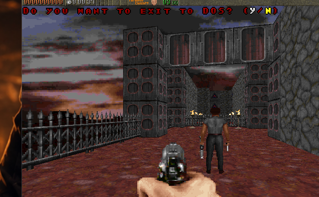

# ROTT94 co-op prototype testing



## Two copies on one Windows PC

Run this from PowerShell in the repository root:

```powershell
.\tools\launch-local-coop.ps1
```

By default, a dead player automatically respawns at the map's original start
with reset weapons and power-ups. To use the harder rule where any player death
restarts the level for both players, run:

```powershell
.\tools\launch-local-coop.ps1 -RestartOnDeath
```

The script creates isolated `host` and `client` directories under the ignored
Release output folder, copies the runtime into both, places the commercial data
in each copy's required `assets` subfolder, then starts:

- Host: `-net -server -players 2`
- Client: `-net 127.0.0.1`

Both also receive conservative local-test flags that skip the intro and disable
sound, mouse, and joystick initialization. This avoids two old SDL instances
contending during startup; keyboard controls remain available.

Each run records separate host and client output/error logs beside its copied
executable so a setup or synchronization crash can be diagnosed.

The two processes use the default UDP port 34858. Use Alt+Tab to configure each
copy. The host selects **CO-OP CAMPAIGN** once both copies reach the multiplayer
menus.

The launcher intentionally uses the Win32 build. The inherited DOS-era engine
still contains pointer-sized assumptions that make its x64 build unreliable.

## Two computers on a LAN

Build the small graphical launcher with:

```powershell
.\tools\CoopLauncher\build.ps1
```

Place `Rott94CoopLauncher.exe` beside `Rott94.Windows.Release.exe` in the
portable game folder on both computers. The host clicks **HOST** and gives the
displayed LAN address to the second player, who enters it and clicks **JOIN**.
If the portable folder has no registered data yet, the launcher imports the
three required files from a default Ludicrous Edition Steam installation. It
offers a folder picker when Steam is installed in another library location.
Allow the game through Windows Firewall on Private networks. No router port
forwarding is required when both computers are on the same LAN.

The launcher creates a `diagnostics` folder beside the executable. It records
game process starts and exit codes in `launcher-session.log`, and configures
Windows to place full crash dumps in `diagnostics\crash-dumps`. If a LAN test
crashes, preserve that folder from the affected computer for diagnosis.

For the original single-player game, click **SINGLE PLAYER** in the same
launcher. This also imports the registered data when needed, but starts the game
without networking. Starting the bare game executable only works after an
`assets` folder has already been imported.

## Co-op controls

- `F12` on the host rallies the other player to the nearest safe empty tile
  beside the host. The client cannot initiate a Rally.
- `F10` on the host applies a synchronized boss-test boost to both players:
  full health, all keys, MP40, and unlimited KES ammunition.
- `F9` on the host defeats all active enemies (boss helpers that must remain
  alive are excluded).
- `F8` on the host restarts the current level for both players.
- `Shift+F9` gives the player pressing it the real timed Dog Mode power-up.
- `Shift+F10` gives the player pressing it the real timed God Mode power-up.
- `Escape` opens the network-safe end/leave confirmation. Press `N` to
  continue or `Y` to confirm.

This local setup is useful for checking connection, menus, map loading, player
collision, shared keys, exits, and both co-op death rules. Only the
focused game window receives keyboard input, so it is not a substitute for two
PCs when checking simultaneous movement.

## Advanced renderer regression test

After building the Win32 game, run the repeatable Area 1 visual and gameplay
smoke test from the repository root:

```powershell
.\tools\test-advanced-renderer.ps1
```

The test captures 20 matched classic/advanced views covering all four compass
directions, steep vertical look, indoor and outdoor spaces, masked walls,
actors, pickups, a pressure plate, a spring, a fire jet, and the late corridor.
It also compares both Area 1 door orientations
while closed, half-open, and fully open: the vertical entrance door at
`(23,72)` and the horizontal three-door bank at `(42,28)`. This covers distinct
door planes and artwork, as well as area connectivity. The suite verifies that
an Area 1 elevator disk renders distinctly at the ceiling, midpoint, and floor.
It also verifies that the advanced flashlight changes the rendered frame and
plays both shipped deterministic demos through the advanced renderer. When
ImageMagick is installed, the paired captures are combined into
`renderer-regression-montage.png` beside the Release executable for visual
review.

Use `-Configuration Debug` to repeat the same suite with the Debug executable.
The harness automatically uses the registered Release data directory when the
Debug output has no commercial `assets` folder of its own.

## Current prototype limits

- Windows, direct-IP, and two players only.
- No room-code service or internet relay yet.
- No join-in-progress yet.
- Network compatibility with unmodified ROTT builds is not supported.
