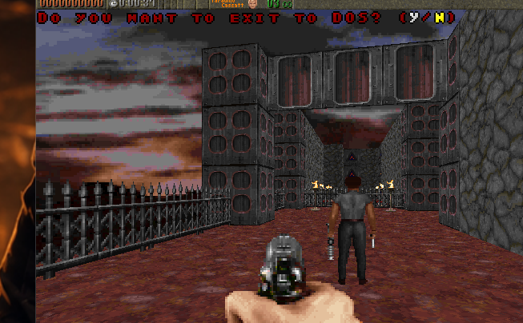

# Rott94

## About
This is a source port of Apogee's DOS FPS game [Rise of the Triad](http://en.wikipedia.org/wiki/Rise_of_the_Triad), originally released in 1994 (Shareware) and 1995 (Full version).

## Campaign co-op prototype

This fork adds experimental two-player campaign co-op to the Windows port,
including shared campaign progression, co-op enemy targeting, player respawns,
no friendly fire, a host Rally command, and synchronized level transitions.
See [COOP_TESTING.md](COOP_TESTING.md) for the current setup instructions,
controls, and known limitations.

**[Download the latest ready-to-run Windows co-op build](https://github.com/tuin-boop/rott94/releases/latest)**

The download does not contain commercial game data. Its launcher can import
the required files from an installed Steam copy of Rise of the Triad:
Ludicrous Edition.

## Installing
1. Enable unknown sources (and optionally debug connections for ADB support)
2. Copy APK file to device (APKs can be downloaded from https://github.com/h4mu/rott94/releases)
3. Open package and install it
4. Copy game files to /sdcard/Android/data/io.github.h4mu.andrott/files/ (e.g. by using "adb push")

## Playing
When running the game and if the game files are in the right place the intro animation should come up. Touch controls emulate the keyboard.

The screen surface is divided into 9 equal parts in a 3x3 matrix, a touch in each of these represents the following actions:

|  |  |  |
:--- | :---: | ---:
Move Forward | Enter/Switch weapon | Move Forward
Turn Left | Space/Open | Turn Right
Move Back | Escape | Shoot
